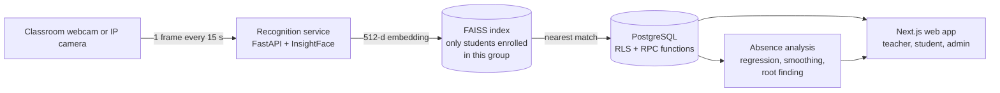

# SUSAN

**Attendance that takes itself, and tells teachers who is about to drop out.**

Taking attendance by hand eats the first minutes of every class, and the paper lists never get analyzed. SUSAN is a university project (UNACH, Chiapas) that does both jobs: the classroom camera recognizes enrolled students and records attendance, and the absence history is analyzed with numerical methods to flag students at risk before it's too late.

> The technical documentation, written for the course, is in Spanish: [README.es.md](README.es.md).

## How it works



1. The teacher's webcam (or an IP camera) sends a frame every 15 seconds.
2. The recognition service detects faces, computes a 512-d embedding in memory and searches the nearest neighbor in FAISS, **only among students of that group who gave consent**.
3. A student is marked present after 3 valid readings in different frames. Doubtful matches go to a review queue for the teacher.
4. Without a camera or without consent, the teacher takes attendance manually.

## Highlights

- **All business rules live in PostgreSQL.** 20 normalized tables, triggers, Row-Level Security and 90+ RPC functions. The web app only talks to the database through those functions.
- **Biometric data is handled carefully.** No face vectors or images are stored in tables, the index lives in a private bucket, every file is served through signed URLs that expire in 5 minutes, and every access is logged.
- **Numerical methods, shown step by step.** Linear regression, smoothing, projection with root finding (when will this student cross 20% absences?) and an explainable risk score, with the iteration tables visible in the app.
- **Heavily tested.** The SQL test suite has 1,232 positive and 801 negative assertions against a real PostgreSQL 16, plus Vitest for the app and pytest for the recognition service.

## Stack

| Part | Tech |
|---|---|
| Web app | Next.js 16, React 19, Tailwind 4, shadcn/ui |
| Database | PostgreSQL 16 on Supabase (Auth, Storage, RLS) |
| Face recognition | Python, FastAPI, InsightFace, FAISS |
| Analysis | Numerical methods in plain JavaScript |

## Run it locally

You need Node 20.9+, PostgreSQL 16 and Python 3.12 (only for the recognition service).

```bash
cd web && npm install && cd ..
scripts/dev-all.sh        # database, demo data, recognition service and web app on http://localhost:3000
scripts/dev-stop.sh
```

Demo accounts (local mode only, password `demo1234`): `admin@susan.local`, `docente1@susan.local`, `e260001@susan.local`. All names and data in the demo are fictional.

The pretrained InsightFace models are for non-commercial use only.
